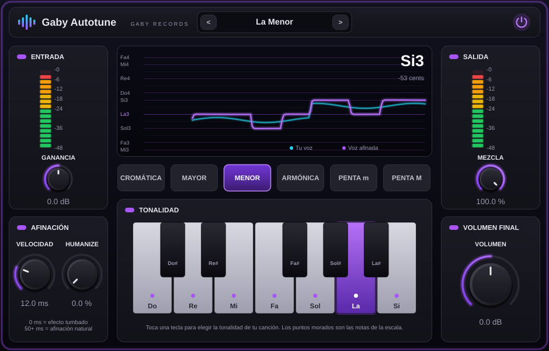

# Gaby Autotune

Plugin de autotune para voz de **Gaby Records**, en formato **AU** y **VST3** para Mac.
Funciona en ACE Studio y en cualquier programa de música que acepte plugins de efectos.



## Controles

| Control | Qué hace |
|---|---|
| **Tonalidad** | La nota base de tu canción (Do, Re, Mi…). Se cambia arriba con `<` `>` o tocando el teclado. |
| **Escala** | Cromática, Mayor, Menor, Menor armónica, Pentatónica menor y mayor. |
| **Velocidad** | 0 ms = efecto tumbado/robótico. 50–150 ms = afinación natural. |
| **Humanize** | Suaviza la corrección en notas largas para conservar el vibrato. |
| **Ganancia** | Volumen que entra al plugin. |
| **Mezcla** | 100 % = solo la voz afinada. |
| **Volumen final** | Volumen de salida. |
| **Encendido** | Prende o apaga el efecto. |

La pantalla muestra tu voz en **cian** y la voz afinada en **morado**.

## Cómo obtener el plugin

GitHub lo compila solo cada vez que subes cambios:

1. Entra a la pestaña **Actions** de este repositorio.
2. Abre la última ejecución con palomita verde ✅.
3. Abajo, en **Artifacts**, descarga **Gaby-Autotune-Mac**.
4. Descomprime y sigue las instrucciones de `INSTALAR.txt`.

## Para programadores

```bash
cmake -B build -DCMAKE_BUILD_TYPE=Release
cmake --build build --config Release
```

Hecho con [JUCE](https://juce.com) 8. Detección de tono con YIN y corrección con un
pitch shifter de doble lectura sincronizado al periodo de la voz.
